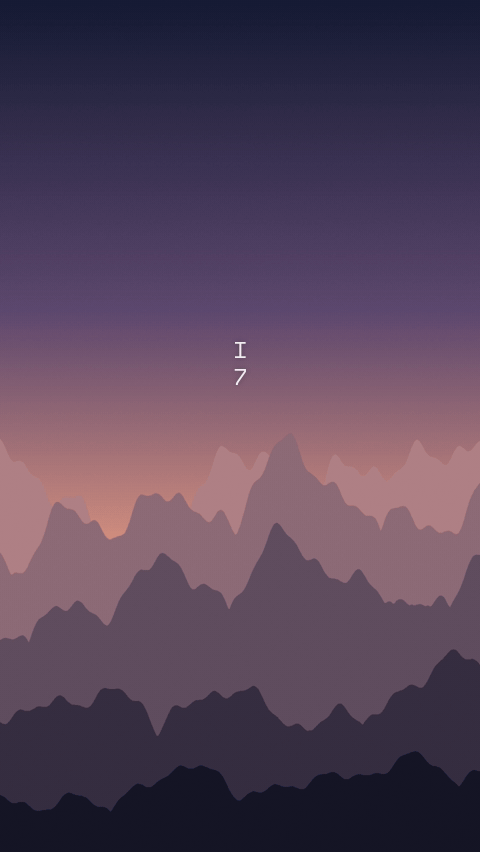

<p align="center"></p>

<p align="center">
  <a href="https://github.com/ludodelot/decode-text-overlay/actions/workflows/ci.yml"></a>
  
  
  
</p>

<p align="center">
  <b>Text that grows from the center as random glyphs, then resolves into your phrase.</b><br>
  A layer for photos, videos and websites. Works as a Claude Code skill, from Codex, as a CLI and as a web component.
</p>

<p align="center">
  <a href="https://ludodelot.github.io/decode-text-overlay/web/demo.html"><b>Live demo with controls</b></a> ·
  <a href="#install">Install</a> ·
  <a href="#use-it-with-claude-code">Claude Code</a> ·
  <a href="#use-it-with-codex">Codex</a> ·
  <a href="#cli">CLI</a> ·
  <a href="#on-a-website">Website</a>
</p>

<p align="center"></p>

## How it works



The phrase sits in a centered monospace grid, so it can grow outward from the middle. Each character has two random moments: when it appears and when it resolves. In between it shows a glyph that changes about 24 times a second. The randomness is a hash of seed, position and tick: the same seed always gives the same animation, in Python and in JavaScript (a test compares them frame by frame).

## One input, six outputs



| You want | Add this | Result |
|---|---|---|
| Text burned onto a photo or video | `--bg photo.jpg -o story.mp4` | final mp4, video audio kept |
| A layer for Premiere, CapCut or DaVinci | `-o overlay.mov` | ProRes 4444 with alpha (`.webm` = VP9 alpha) |
| A GIF for chat or docs | `--bg photo.jpg --width 480 -o text.gif` | looping GIF |
| An animated SVG, no JS | `-o text.svg --svg-bg "#16101a"` | tiny file that plays inside `` |
| PNG frames | `-o frames/` | `frame_00000.png`... |
| A website | `web/decode-text.js` | `<decode-text>` web component |

<p align="center">
  
  
</p>

For 4K, render at the size you want: `--size-px 2160x3840`, or use a 4K `--bg`.

## Install

Needs Python 3.9+ and `ffmpeg`.

```bash
# as a command (recommended)
pipx install git+https://github.com/ludodelot/decode-text-overlay
decode-text-overlay -t "EVEREST\n8,849 M" --bg ridge.jpg -o story.mp4

# or from a clone
git clone https://github.com/ludodelot/decode-text-overlay && cd decode-text-overlay
python3 -m venv .venv && .venv/bin/pip install pillow
```

## Use it with Claude Code



**As a plugin** (any project):

```
/plugin marketplace add ludodelot/decode-text-overlay
/plugin install decode-text-overlay@decode-text-overlay
```

**Or copy the skill.** The folder is self-contained (script and font included):

```bash
cp -R skills/decode-text-overlay ~/.claude/skills/
```

Inside a clone of this repo the skill is already wired through `.claude/skills/`. Then ask in plain language:

- *"Put 'EVEREST 8,849 M' over ridge.jpg as a decoding text, 9:16."*
- *"Make a transparent overlay with K2 and its coordinates for CapCut."*
- *"Add a `<decode-text>` caption to the hero of my landing page."*

Claude reads `SKILL.md`, runs the renderer, extracts a frame and checks legibility before answering.

## Use it with Codex

Codex reads [`AGENTS.md`](AGENTS.md) at the repo root, which explains how to run the renderer. Open Codex in this repo and ask:

```bash
codex "add a decode text layer with K2, 8,611 M to ridge.jpg and export an mp4"
```

For another project, copy `AGENTS.md` into it (or paste its "Render" section into your own) and point the script path at your clone, or install the `decode-text-overlay` command with pipx. If your Codex version supports skills, copying `skills/decode-text-overlay` into its skills folder also works.

## CLI

```bash
decode-text-overlay --preset cinematic \
  -t "EVEREST\n8,849 M" -t "27.9881° N\n86.9250° E" -t "NEPAL · CHINA" \
  --bg ridge.jpg --color auto -o story.mp4
```

Each `-t` is one phrase, shown in order. Phrases over 12 characters split into two balanced lines (`--wrap 0` disables it); `\n` chooses the break yourself.

**Presets** set a coherent style; any flag you add overrides them.

| Preset | Feel | Key settings |
|---|---|---|
| `story` (default) | music-release story | small, wide tracking, random order |
| `minimal` | quiet and elegant | smaller, slow decode, soft exit |
| `cinematic` | titles and credits | very wide tracking, center order, long hold, exit |
| `poster` | big and bold | large size, strong shadow |
| `terminal` | green console | tight tracking, left to right, no shadow |
| `lowerthird` | captions near the bottom | `--y 0.86`, left to right, exit |

| Option | Default | Meaning |
|---|---|---|
| `--decode` / `--hold` / `--exit` | 0.9 / 1.3 / 0 | seconds to resolve / keep / dissolve back (0 = hard cut) |
| `--order` | random | `random`, `center` or `ltr`: how glyphs resolve |
| `--loop`, `--duration` | off | repeat the sequence; total length |
| `--size`, `--tracking` | 0.036, 0.18 | font size (fraction of width), letter spacing (em) |
| `--x`, `--y` | 0.5, 0.5 | text center, 0 to 1 |
| `--color`, `--shadow`, `--opacity` | white, 0.35, 0.95 | `--color auto` picks white or dark from the `--bg` under the text |
| `--font` | Space Mono | any monospace `.ttf` |
| `--width`, `--fps`, `--seed` | none, 30, 7 | downscale (GIFs), frame rate, same seed = same animation |

`--help` lists everything. Regenerate the examples with `examples/make_examples.sh` and the graphics with `assets/make_assets.py`.

## On a website

```html
<div style="position:relative">
  
  <decode-text loop order="center" exit="0.6" texts="EVEREST\n8,849 M|27.9881° N\n86.9250° E"></decode-text>
</div>
<script src="decode-text.js"></script>
```

Attributes: `texts` (`|` separates phrases), `wrap`, `decode`, `hold`, `exit`, `order`, `tick`, `seed`, `loop`, `paused`. Style it with the CSS variables `--dt-font`, `--dt-size`, `--dt-tracking`, `--dt-color`, `--dt-shadow`. It fires `decode-end` when the last phrase resolves, shows the final text when the visitor prefers reduced motion, and works over `<video>` too. The [live demo](https://ludodelot.github.io/decode-text-overlay/web/demo.html) generates the HTML and the matching CLI command for you. The file is ready to publish to npm as `@ludodelot/decode-text`.

## Good defaults

- Keep it small, around 3 to 4 percent of the width. The motion carries the effect.
- One or two lines, up to about 24 characters each.
- On a busy or bright photo, use `--color auto` or raise `--shadow`.

## Development

```bash
python -m unittest discover -s tests -v   # unit tests, JS/Python parity, real renders
```

CI runs the same on Python 3.10 and 3.12. Changes to the animation must be made in both `decode_overlay.py` and `web/decode-text.js`; the parity test fails otherwise. See [CHANGELOG.md](CHANGELOG.md).

## License

MIT. Bundled font: Space Mono (SIL OFL 1.1, see `skills/decode-text-overlay/fonts/OFL.txt`).
